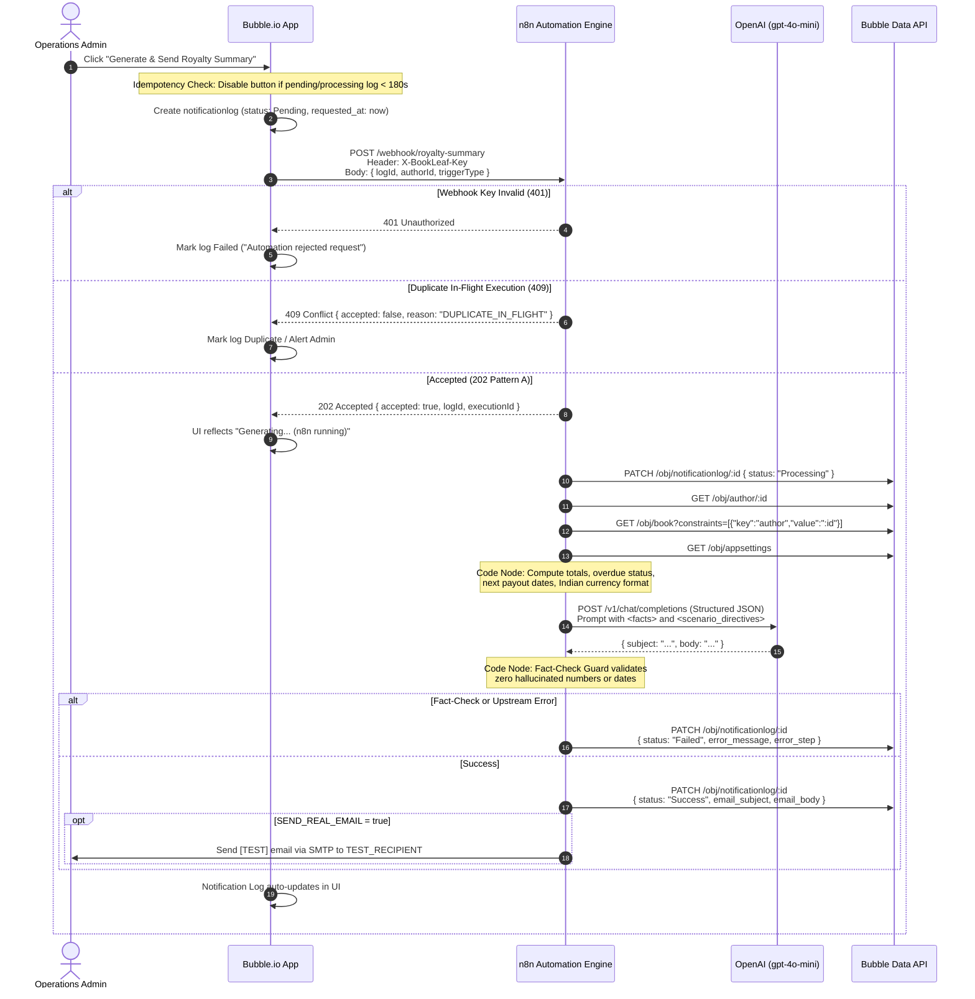
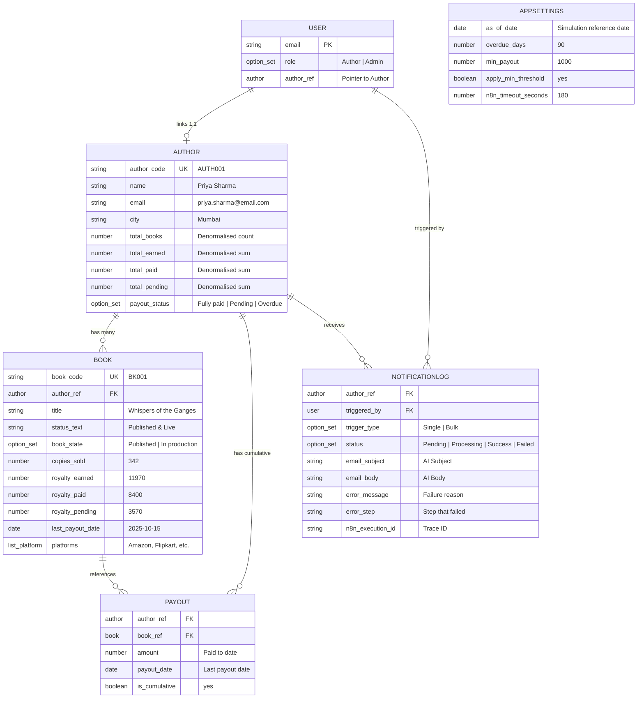

# BookLeaf Publishing — Technical Assignment 2: Author Royalty Dashboard & Automated Notification System

> **Platform**: Bubble.io + n8n Automation Engine + AI LLM API (OpenAI / Anthropic / Gemini)  
> **Candidate**: Toshak Parmar | **Reviewer**: Musavir (`musavir@bookleafpub.in`)  
> **Confidential Assignment**: Private submission for BookLeaf Full-Stack Developer recruitment.

---

## 1. Executive Summary & Architecture Overview

BookLeaf Publishing relies on Bubble.io for core operational tracking (author dashboards, book catalog, production tracking) and n8n for enterprise workflow automation. This project delivers an end-to-end integrated solution satisfying all requirements of Technical Assignment 2:

1. **Bubble.io Author & Operations Application**:
   - **Author Portal**: Authenticated dashboard where authors see strictly their own published and in-production books, quarterly royalty metrics (earned, paid, pending in Indian Rupee format), and dynamic **Green / Yellow / Red** status badges.
   - **Admin Portal**: Internal desk with author overview, search, filters by city and payout status (`Fully paid`, `Pending`, `Overdue`), detailed author view with cumulative payout history, single-author summary trigger, and bulk triggering for all pending authors.
   - **Author Data Isolation**: Server-enforced privacy rules completely isolating authors from viewing or querying other authors' data.
   - **Resilience**: Zero infinite spinners; frontend error handling catches offline webhooks and provides Retry actions; in-flight idempotency locks prevent double-click race conditions.
2. **n8n Automation Engine (`n8n/royalty-summary-workflow.json`)**:
   - **Authenticated Webhook**: Protected with custom header secret (`X-BookLeaf-Key`).
   - **Asynchronous Architecture (Pattern A)**: Immediately acknowledges with `202 Accepted`, fetches fresh records via the Bubble Data API, constructs deterministic facts, calls the AI API, and updates Bubble's `notificationlog` via Data API PATCH.
   - **Fact-Check Guard**: Validates that all currency figures and dates in the AI response strictly match verified operational facts with zero hallucinations.
   - **Resilience & Shared Failure Branch**: Catches upstream timeouts or errors, updating Bubble's notification log to `Failed` with step names and error messages.
3. **Reference Logic & Local Verification Suite**:
   - Node/TypeScript reference implementation (`logic/royalty-engine.js`) with 100% test coverage (`node --test logic/royalty-engine.test.js`).
   - In-memory mock Bubble Data API (`harness/mock-bubble-api.mjs`) and mock LLM (`harness/mock-llm.mjs`) running 17 end-to-end integration and failure-injection tests (`npm run test:harness`).

---

## 2. End-to-End System Architecture



---

## 3. Bubble.io Database Schema Rationale



### Architectural Decisions:
1. **Denormalised Author Totals (`total_earned`, `total_pending`, `payout_status`)**:
   - *Rationale*: Searching, sorting, and filtering authors by pending amount and status in Bubble repeating groups is slow if evaluated on-the-fly via nested aggregations (`Search for books:each item's royalty_pending:sum`).
   - *Integrity*: The `book` table remains the single source of truth. Author totals are recalculated deterministically via the *Recalculate Author Stats* workflow upon import, when settings change, or on demand.
2. **Cumulative Payout Entity (`payout`)**:
   - *Dataset Reality*: The sample dataset records cumulative `royalty_paid` and `last_royalty_payout_date` on each book, but lacks individual historical transaction receipts.
   - *Solution*: We create one `payout` record per book where `royalty_paid > 0`, explicitly noting `"Total paid to date (last payout on <date>)"` and setting `is_cumulative = yes`. This adheres to database normalization without fabricating artificial historical dates.
3. **As-Of Date Simulation (`AppSettings.as_of_date`)**:
   - *The Reality*: The dataset contains payout dates from late 2025. Evaluating against current calendar dates in late 2026 would make every pending author overdue and red.
   - *Solution*: Admin-configurable `as_of_date` preset to `2025-12-15` shows the authentic intended distribution (1 Fully paid, 4 Pending, 5 Overdue). If cleared, it calculates against real current time.

---

## 4. Ground Truth: Dataset Verification & Author Status Matrix

All 10 authors and 18 books (16 published, 2 in production) have been validated against dataset invariants (`copies * royalty_per_copy == earned`; `paid + pending == earned`):

| Author ID & Name | City | Books | Earned (₹) | Paid (₹) | Pending (₹) | Status (As-Of 2025-12-15) | Bulk Eligible? |
|---|---|---|---|---|---|---|---|
| **AUTH001 Priya Sharma** | Mumbai | 2 | 19,908 | 16,338 | 3,570 | **Pending** | Yes |
| **AUTH002 Rohit Kapoor** | Delhi | 2 | 84,024 | 71,000 | 13,024 | **Overdue** (BK003 is 105d) | Yes |
| **AUTH003 Ananya Reddy** | Hyderabad | 1 | 2,546 | 0 | 2,546 | **Overdue** (Never paid, pub > 90d) | Yes |
| **AUTH004 Vikram Joshi** | Pune | 2 | 15,195 | 11,845 | 3,350 | **Overdue** (BK006 is 117d) | Yes |
| **AUTH005 Meera Nair** | Kochi | 2 | 25,295 | 22,240 | 3,055 | **Pending** | Yes |
| **AUTH006 Arjun Malhotra** | Chandigarh | 1 | 2,464 | 0 | 2,464 | **Overdue** (Never paid, pub > 90d) | Yes |
| **AUTH007 Sneha Kulkarni** | Bangalore | 3 (1 in prod.) | 60,865 | 53,000 | 7,865 | **Pending** | Yes |
| **AUTH008 Farhan Sheikh** | Lucknow | 1 | 3,120 | 3,120 | 0 | **Fully paid** | **No** (Pending = 0) |
| **AUTH009 Kavita Deshmukh**| Nagpur | 2 (1 in prod.) | 850 | 0 | 850 | **Pending** (Rolls over < ₹1k) | Yes |
| **AUTH010 Diya Chatterjee** | Kolkata | 2 | 29,115 | 25,000 | 4,115 | **Overdue** (BK018 never paid) | Yes |

---

## 5. Bubble ↔ n8n Integration: Pattern A vs Pattern B

### Why Fetch via Data API inside n8n?
1. **Least Privilege**: The webhook passes only record IDs (`logId`, `authorId`, `triggerType`). No author contact details or sensitive royalty figures are transmitted in browser network payloads.
2. **Data Freshness**: n8n fetches fresh database state at execution time, avoiding discrepancies from client caching.
3. **Bubble Workflows Simplicity**: Constructing complex nested-list JSON in Bubble expressions is error-prone. Passing IDs keeps Bubble workflows concise and robust.

### Switching Between Pattern A and Pattern B:
The workflow contains a `CALLBACK_MODE` setting in its `Configuration` node:
- **Pattern A (Default / Asynchronous)**: Webhook answers `202 Accepted` immediately. n8n processes asynchronously and updates Bubble via Data API PATCH.
- **Pattern B (Synchronous)**: Webhook responds after AI completion with `{ status, subject, body }`. Bubble workflow writes the response directly to the log.

---

## 6. AI Prompt Strategy & Fact-Check Guard

### System & User Prompt Design
- **System Prompt** (`n8n/prompts/system.md`): Establishes BookLeaf author relations persona. Warm, empathetic, professional tone; owns delayed royalties with zero corporate deflection; explains quarterly cycles (45-day post quarter-end window); explains the ₹1,000 rollover rule.
- **Pre-Formatted Facts**: The n8n Code node pre-formats all numbers (`₹19,908`, `342`) and dates (`14 Feb 2026`). The LLM is instructed: *"Copy every amount and date exactly as given. Do not calculate, round, or reformat."*
- **Scenario Directives**: Dynamically attached per author:
  - `ALL_PAID`: Confirms complete settlement and thanks the author.
  - `BELOW_THRESHOLD`: Clarifies that balances under ₹1,000 roll over per policy, reassuring that this is normal procedure rather than a delay.
  - `OVERDUE`: Apologises, acknowledges delay, and promises 48-hour team escalation response.
  - `HAS_IN_PRODUCTION`: Explains current production milestone and reassures that emails will arrive at each subsequent stage.
- **Fact-Check Guard** (`n8n/nodes/validate-ai-output.js`):
  - Validates JSON `{ "subject": string, "body": string }`.
  - Checks word count (150–400 words).
  - Asserts that author's first name is present in greeting.
  - Forbids markdown headings (`#`) and unpopulated placeholders like `[Author Name]`.
  - **Zero Hallucination Guarantee**: Extracts all rupee patterns (`₹[\d,]+`) from the generated body and verifies that every single amount exists in the pre-computed facts list.

---

## 7. Error-Handling Matrix & Resilience Verification

| Failure Scenario | n8n Behavior | Bubble UI Behavior | Tested in Harness? |
|---|---|---|---|
| **Wrong / Missing Webhook Key** | Rejected immediately with `401 Unauthorized`. | Caught by API Connector error handler; log marked `Failed`; alert displayed; no spinner. | ✅ Yes |
| **n8n Down / Unreachable** | — | Workflow catches connection error; log marked `Failed` (`"Could not reach automation service"`); enables Retry. | ✅ Yes |
| **Double-Click Race Condition** | In-flight lock rejects 2nd request within 120s with `409 Conflict`. | Button is disabled client-side; on 409, log marked `Duplicate`. | ✅ Yes |
| **Bubble Data API 500 on Fetch** | Retries 3×; transitions to shared failure branch. | Log stays `Pending` until n8n PATCHes `Failed` or client timeout (180s) triggers Retry. | ✅ Yes |
| **AI LLM API Outage / 500** | Retries 3× with exponential backoff; transitions to failure branch. | Log patched to `Failed` (`error_step: "AI Royalty Summary Generation"`); shows error banner. | ✅ Yes |
| **AI Returns Bad JSON or Hallucination** | Fact-Check Guard catches error; transitions to failure branch. | Log patched to `Failed` (`error_step: "Validate AI Output"`); shows validation message. | ✅ Yes |
| **Execution Crash / Silent Failure** | Global Error Handler workflow (`error-handler-workflow.json`) logs critical error. | Bubble client-side timer treats log as **Timed out** after 180s; shows "Retry" button. | ✅ Yes |

---

## 8. Test Login Credentials

| Role | Persona | Email | Password | What to Verify |
|---|---|---|---|---|
| **Author** | Priya Sharma (`AUTH001`) | `priya.sharma@email.com` | `Priya@BookLeaf2026` | 2 published books, ₹3,570 pending within normal cycle |
| **Author** | Rohit Kapoor (`AUTH002`) | `rohit.kapoor@email.com` | `Rohit@BookLeaf2026` | 2 published books, ₹13,024 pending, Overdue status |
| **Author** | Farhan Sheikh (`AUTH008`) | `farhan.sheikh@email.com` | `Farhan@BookLeaf2026` | 1 published book, ₹0 pending (fully settled) |
| **Admin** | Operations Admin | `admin@bookleafpub.in` | `Admin@BookLeaf2026` | Full catalog, filters, single trigger, bulk trigger, audit logs |

---

## 9. Quickstart & Verification Commands

```bash
# 1. Install dependencies
npm install

# 2. Run reference royalty engine unit tests (all 8 suites)
npm run test:royalty

# 3. Run complete local end-to-end test harness (17 tests: all 10 authors + error matrix)
npm run test:harness

# 4. Generate sample emails for all 10 authors into docs/samples/
npm run generate:samples

# 5. Dry-run Bubble dataset seeder
npm run seed:bubble:dry

# 6. Live seed Bubble Data API (requires BUBBLE_API_TOKEN in .env)
npm run seed:bubble
```

---

## 10. Deliverables Directory Map

```
BookLeaf/
├── bubble/                         # Bubble.io Build Kit
│   ├── SCHEMA.md                   # Complete database schema, ER diagram, privacy rules
│   ├── BUILD_GUIDE.md              # Click-by-click build guide for Bubble editor
│   ├── API_KEYS.md                 # Bubble Data API mapping & constraint queries
│   ├── IMPORT.md                   # CSV & Data API import instructions
│   └── import/                     # Pre-formatted import CSVs (authors, books, payouts, appsettings)
├── n8n/                            # n8n Automation Workflows & Logic
│   ├── royalty-summary-workflow.json # Main importable production workflow
│   ├── error-handler-workflow.json # Global error trigger workflow
│   ├── README.md                   # n8n setup, credentials, and deployment guide
│   ├── prompts/                    # System and user prompt templates
│   └── nodes/                      # Standalone JavaScript scripts for n8n Code nodes
├── logic/                          # Reference Logic Implementation
│   ├── royalty-engine.js           # Core deterministic calculation & validation engine
│   ├── royalty-engine.test.js      # Unit tests (currency, dates, invariants, edge cases)
│   └── royalty-engine.d.ts         # TypeScript definitions
├── harness/                        # Local Test Harness & Mock Services
│   ├── mock-bubble-api.mjs         # In-memory Bubble Data API server
│   ├── mock-llm.mjs                # Mock OpenAI Chat Completions API server
│   ├── docker-compose.yml          # Offline Docker stack for n8n + mock services
│   └── Dockerfile.mock             # Container buildfile for mock services
├── docs/                           # Documentation Deliverables
│   ├── ASSUMPTIONS.md              # Plan constraints, pre-flight findings, architectural choices
│   ├── PRIVACY_TEST.md             # Author isolation test script & checklist
│   ├── LIVE_TEST_PLAN.md           # Step-by-step test plan for real Bubble + n8n + LLM
│   ├── LEARNING_LOG.md             # TEMPLATE ONLY with daily prompts for candidate
│   ├── LOOM_SCRIPT.md              # 4–5 minute timed walkthrough script
│   ├── SUBMISSION_EMAIL.md         # Final submission email draft
│   └── samples/                    # Generated sample emails for all 10 authors
└── scripts/                        # Automation & Verification Scripts
    ├── test-harness.mjs            # 17-test end-to-end integration test runner
    ├── seed-bubble.mjs             # Bubble Data API seeder with invariant checks
    ├── build-n8n-workflow.mjs      # Workflow compiler embedding scripts & prompts
    ├── generate-samples.mjs        # 10-author sample email generator
    └── generate-csvs.mjs           # CSV generator from sample data
```

---

## 11. Known Limitations & Future Architecture Roadmap

### Free-Plan Constraints & Workarounds
1. **No Backend Workflows on Free Plan**:  
   - *Impact*: Database triggers, backend recurrence, and server-side loops are paid Bubble features.
   - *Implemented Workaround*: Bulk triggering runs via a throttled frontend recursive custom event (`process_author_queue`) with 2-second scheduled delays. Admins keep the page open during batch runs.
2. **Stale Log Cleanup**:  
   - *Impact*: Inability to run scheduled hourly cron jobs to mark abandoned logs as `Failed`.
   - *Implemented Workaround*: Client-side dynamic evaluation: if a log is `Pending`/`Processing` for >180 seconds, the UI automatically displays `"Timed out — Click to Retry"` and enables an admin action `"Mark Stale Logs as Failed"`.
3. **Bubble `version-test` Collaboration**:  
   - Free apps run on `version-test`. Collaborator access (`musavir@bookleafpub.in`) ensures full editor inspectability.

### Production Improvements on Paid Plan / Code Platform
1. **Background Queue Workers**: Transition bulk triggering to BullMQ / Redis or Bubble Backend Workflows with concurrency limits and automated backoff retries.
2. **Dedicated Delivery & Webhook Signatures**: Implement HMAC-SHA256 signature verification on webhooks (`X-BookLeaf-Signature`), and dispatch transactional emails via SendGrid/Postmark with SPF, DKIM, and DMARC verification.
3. **Migration to NestJS / Next.js Stack**: Transition from Bubble to the code-based platform developed in Assignment 1 for enterprise scalability and sub-100ms response times.
