# Bubble.io Database Schema Specification — BookLeaf Author Royalty System

This document provides the definitive relational data model, option sets, privacy rules, and design rationale for building the BookLeaf application in Bubble.io.

---

## 1. Relational Architecture & ER Diagram

```mermaid
erDiagram
    USER ||--o| AUTHOR : "links 1:1 via user/author"
    AUTHOR ||--o{ BOOK : "has many books"
    AUTHOR ||--o{ PAYOUT : "has many payouts"
    BOOK ||--o{ PAYOUT : "has cumulative payout"
    AUTHOR ||--o{ NOTIFICATIONLOG : "receives summaries"
    USER ||--o{ NOTIFICATIONLOG : "triggered by admin"
    APPSETTINGS ||--|| AUTHOR : "evaluates status relative to"

    USER {
        string email PK
        option_set role "Author | Admin"
        author author_ref "Links to Author record"
    }

    AUTHOR {
        string unique_id PK
        string author_code UK "AUTH001, AUTH002..."
        string name "Author full name"
        string email "Matches User email"
        string phone "Phone number"
        string city "City (Mumbai, Delhi, etc.)"
        date joined_date "Date joined BookLeaf"
        user user_ref "Bubble User relation"
        number total_books "Denormalised count"
        number total_earned "Denormalised sum (INR)"
        number total_paid "Denormalised sum (INR)"
        number total_pending "Denormalised sum (INR)"
        option_set payout_status "Fully paid | Pending | Overdue"
    }

    BOOK {
        string unique_id PK
        string book_code UK "BK001, BK002..."
        author author_ref FK "Relational link to Author"
        string title "Book title"
        string isbn "ISBN number"
        string genre "Genre category"
        date publication_date "Null if in production"
        string status_text "Original string e.g. Published & Live"
        option_set book_state "Published | In production"
        number mrp "Max Retail Price (INR)"
        number royalty_per_copy "Author royalty per copy (INR)"
        number copies_sold "Total copies sold"
        number royalty_earned "Total royalty earned (INR)"
        number royalty_paid "Cumulative royalty paid (INR)"
        number royalty_pending "Current royalty pending (INR)"
        date last_payout_date "Last payout date (null if none)"
        option_set print_partner "In-House | Repro India | Epitome Books"
        list_platform platforms "List of platforms"
    }

    PAYOUT {
        string unique_id PK
        author author_ref FK "Relational link to Author"
        book book_ref FK "Relational link to Book"
        number amount "Paid amount (INR)"
        date payout_date "Date of disbursement"
        boolean is_cumulative "True: represents cumulative total"
        string notes "Audit label e.g. Total paid to date"
    }

    NOTIFICATIONLOG {
        string unique_id PK
        author author_ref FK "Author targeted"
        user triggered_by FK "Admin User who triggered"
        option_set trigger_type "Single | Bulk"
        option_set status "Pending | Processing | Success | Failed | Duplicate"
        date requested_at "Trigger timestamp"
        date completed_at "Callback timestamp"
        string email_subject "AI-generated subject"
        string email_body "AI-generated plain text body"
        string error_message "Failure explanation"
        string error_step "Step where failure occurred"
        string n8n_execution_id "n8n audit ID"
        string ai_model "e.g. gpt-4o-mini / claude-3-5-haiku"
        boolean email_sent_to_test "True if sent to test inbox"
        notificationlog retry_of "Previous failed log if retrying"
        string duplicate_of "Original in-flight log ID"
    }

    APPSETTINGS {
        string unique_id PK
        date as_of_date "Simulation reference date (null = now)"
        number overdue_days "Cutoff threshold (default: 90)"
        number min_payout "Minimum payout threshold (default: 1000)"
        boolean apply_min_threshold "Roll over below min (default: yes)"
        number n8n_timeout_seconds "Timeout threshold (default: 180)"
    }
```

---

## 2. Option Sets

Option sets are lightweight, static enums in Bubble that require zero database reads and prevent typo bugs. Create these first in **Data → Option sets**:

| Option Set Name | Options | Attributes | Purpose |
|---|---|---|---|
| `role` | `Author`, `Admin` | — | User role authorization |
| `book_state` | `Published`, `In production` | — | High-level book status |
| `print_partner` | `In-House`, `Repro India`, `Epitome Books` | — | Vendor identification |
| `platform` | `Amazon India`, `Flipkart`, `Amazon US`, `Amazon UK`, `BookLeaf Store` | — | Distribution channels |
| `notif_status` | `Pending`, `Processing`, `Success`, `Failed`, `Duplicate` | `badge_color` (text: `#F59E0B`, `#3B82F6`, `#10B981`, `#EF4444`, `#6B7280`) | Notification lifecycle state |
| `trigger_type` | `Single`, `Bulk` | — | Trigger source |
| `royalty_status` | `Paid up`, `Within cycle`, `Rolls over`, `Overdue`, `In production` | `color` (text), `badge_text` (text) | Book-level visual status badge |
| `payout_filter` | `All`, `Fully paid`, `Pending`, `Overdue` | — | Author-level filter & summary |

### Detailed Attributes for `royalty_status`:
- **Paid up**: `color` = `#10B981` (Green), `badge_text` = `Paid up`
- **Within cycle**: `color` = `#F59E0B` (Yellow), `badge_text` = `Pending — within normal cycle`
- **Rolls over**: `color` = `#F59E0B` (Yellow), `badge_text` = `Below ₹1,000 minimum — rolls over`
- **Overdue**: `color` = `#EF4444` (Red), `badge_text` = `Overdue`
- **In production**: `color` = `#6B7280` (Grey), `badge_text` = `In production`

---

## 3. Data Types & Fields Specification

> **CRITICAL NAMING RULE**: Use **`lowercase_snake_case` with NO spaces** for all data type and field names. Bubble's Data API generates API endpoint names and JSON payload keys based on the exact internal names. Clean snake_case ensures predictable API interactions between Bubble, n8n, and external scripts.

### 3.1 Type: `user` (Built-in)
| Field Name | Field Type | List? | Description |
|---|---|---|---|
| `email` | text | no | User login email (built-in) |
| `role` | `role` (option set) | no | User access level (`Author` or `Admin`) |
| `author` | `author` | no | Relational pointer to author's profile record |

### 3.2 Type: `author`
| Field Name | Field Type | List? | Description |
|---|---|---|---|
| `author_code` | text | no | Unique ID from dataset: `AUTH001`, etc. |
| `name` | text | no | Full name: "Priya Sharma" |
| `email` | text | no | Author contact email |
| `phone` | text | no | Phone number |
| `city` | text | no | City: "Mumbai", "Delhi", etc. |
| `joined_date` | date | no | Onboarding date |
| `user` | `user` | no | Bidirectional link to User account |
| `total_books` | number | no | Denormalised count of books |
| `total_earned` | number | no | Denormalised total royalty earned (₹) |
| `total_paid` | number | no | Denormalised total royalty paid (₹) |
| `total_pending` | number | no | Denormalised total royalty pending (₹) |
| `payout_status` | `payout_filter` | no | Aggregate status: `Fully paid`, `Pending`, `Overdue` |

### 3.3 Type: `book`
| Field Name | Field Type | List? | Description |
|---|---|---|---|
| `book_code` | text | no | Unique code: `BK001`, `BK002`, etc. |
| `author` | `author` | no | Foreign key reference to parent `author` |
| `title` | text | no | Book title |
| `isbn` | text | no | ISBN string |
| `genre` | text | no | Genre category |
| `publication_date` | date | no | Release date (null for in-production) |
| `status_text` | text | no | Original status (e.g. "In Production - Cover Design") |
| `book_state` | `book_state` | no | `Published` or `In production` |
| `mrp` | number | no | Maximum Retail Price in ₹ |
| `royalty_per_copy`| number | no | Author royalty per copy in ₹ |
| `copies_sold` | number | no | Total volume of copies sold |
| `royalty_earned` | number | no | Total royalty earned in ₹ |
| `royalty_paid` | number | no | Total royalty paid in ₹ |
| `royalty_pending` | number | no | Total royalty pending in ₹ |
| `last_payout_date`| date | no | Last disbursement date (null if never paid) |
| `print_partner` | `print_partner` | no | Print fulfillment provider |
| `platforms` | `platform` | yes | Multi-select list of distribution platforms |

### 3.4 Type: `payout`
| Field Name | Field Type | List? | Description |
|---|---|---|---|
| `author` | `author` | no | Relational link to `author` |
| `book` | `book` | no | Relational link to `book` |
| `amount` | number | no | Cumulative amount disbursed in ₹ |
| `payout_date` | date | no | Date of disbursement |
| `is_cumulative` | yes/no | no | `yes` (dataset assumption: cumulative total to date) |
| `notes` | text | no | "Total paid to date (last payout on <date>)" |

### 3.5 Type: `notificationlog`
| Field Name | Field Type | List? | Description |
|---|---|---|---|
| `author` | `author` | no | Target author |
| `triggered_by` | `user` | no | Admin who initiated the workflow |
| `trigger_type` | `trigger_type` | no | `Single` or `Bulk` |
| `status` | `notif_status` | no | `Pending`, `Processing`, `Success`, `Failed`, `Duplicate` |
| `requested_at` | date | no | Timestamp when triggered |
| `completed_at` | date | no | Timestamp when callback received |
| `email_subject` | text | no | AI-generated email subject line |
| `email_body` | text | no | AI-generated email body text |
| `error_message` | text | no | Error reason if failed |
| `error_step` | text | no | Step that triggered failure (e.g. "AI call") |
| `n8n_execution_id`| text | no | Execution ID from n8n for traceability |
| `ai_model` | text | no | Model used (e.g. "gpt-4o-mini" / "claude-3-5-haiku") |
| `email_sent_to_test`| yes/no | no | `yes` if test email was sent via SMTP |
| `retry_of` | `notificationlog` | no | Pointer to original log if this is a retry |
| `duplicate_of` | text | no | ID of existing in-flight log if blocked |

### 3.6 Type: `appsettings` (Single Row)
| Field Name | Field Type | List? | Description |
|---|---|---|---|
| `as_of_date` | date | no | Simulated date (e.g., 2025-12-15). If empty, use current date. |
| `overdue_days` | number | no | Cutoff days threshold (default: 90) |
| `min_payout` | number | no | Minimum payout threshold in ₹ (default: 1000) |
| `apply_min_threshold`| yes/no | no | If yes, amounts < min_payout roll over (default: yes) |
| `n8n_timeout_seconds`| number | no | Frontend timeout threshold before allowing retry (default: 180) |

---

## 4. Design Decisions & Rationale

### 4.1 Denormalisation of Author Totals
- **Why**: Searching, sorting, and filtering authors by `total_earned`, `total_pending`, and `payout_status` in Bubble repeating groups is slow and complex if calculated on-the-fly via nested aggregations (`Search for books:each item's royalty_pending:sum`).
- **Single Source of Truth**: The `book` table remains the canonical source of truth. Author totals are recalculated deterministically via the *Recalculate Author Stats* workflow:
  1. Automatically upon CSV / Data API import.
  2. Whenever the admin modifies `AppSettings.as_of_date` or threshold parameters.
  3. On demand via the "Recalculate All Author Stats" button in `admin_settings`.

### 4.2 Payout History Entity (`payout`)
- **Dataset Reality**: The sample dataset provides `total_royalty_earned`, `royalty_paid`, and `last_royalty_payout_date`, but does **not** provide individual historical transaction logs.
- **Architectural Solution**: We create a dedicated `payout` table with one record per published book where `royalty_paid > 0`. Each record stores the cumulative paid amount, the `last_royalty_payout_date`, and a flag `is_cumulative = yes` with explanatory note "Total paid to date (last payout on <date>)". This adheres to relational integrity and allows the UI to present a clean payout history without fabricating fake historical dates or fake transaction batches.

### 4.3 Simulation via `AppSettings.as_of_date`
- **The Problem**: The dataset was recorded in late 2025 (`last_royalty_payout_date` ranges between August and December 2025). When reviewers test the app in late 2026 against `Current date/time`, every single pending book would be >300 days since last payout, rendering all pending authors Red ("Overdue") and ruining the demonstration of the green/yellow/red status matrix.
- **The Solution**: An admin-configurable `as_of_date` in `appsettings`. When set to `2025-12-15`, reviewers see the exact realistic distribution: 1 Fully paid, 4 Pending, 5 Overdue. When empty, it falls back to the real current date.

---

## 5. Privacy Rules Specification (Assignment Requirement A4)

Bubble privacy rules enforce server-side security. Even if a user inspects browser network payloads or tampers with URL parameters, unauthorized rows are omitted before leaving Bubble's servers.

### 5.1 Privacy Rules Table
| Data Type | Rule Name | Condition | Permissions |
|---|---|---|---|
| **`author`** | Admin Access | `Current User's role is Admin` | View all fields, Find in searches |
| | Author Self Access | `This author's user is Current User` | View all fields, Find in searches |
| | Everyone Else | *(Default fallback)* | **No permissions** (all unchecked) |
| **`book`** | Admin Access | `Current User's role is Admin` | View all fields, Find in searches |
| | Author Own Books | `This book's author's user is Current User` | View all fields, Find in searches |
| | Everyone Else | *(Default fallback)* | **No permissions** (all unchecked) |
| **`payout`** | Admin Access | `Current User's role is Admin` | View all fields, Find in searches |
| | Author Own Payouts | `This payout's author's user is Current User` | View all fields, Find in searches |
| | Everyone Else | *(Default fallback)* | **No permissions** (all unchecked) |
| **`notificationlog`** | Admin Only | `Current User's role is Admin` | View all fields, Find in searches |
| | Everyone Else | *(Default fallback)* | **No permissions** (all unchecked) |
| **`appsettings`** | Logged In Users | `Current User is logged in` | View non-sensitive fields (`as_of_date`, `overdue_days`, `min_payout`, `apply_min_threshold`), Find in searches |
| | Everyone Else | *(Default fallback)* | **No permissions** (all unchecked) |
| **`user`** | Admin Access | `Current User's role is Admin` | View all fields, Find in searches |
| | Self Access | `This User is Current User` | View all fields, Find in searches |
| | Everyone Else | *(Default fallback)* | **No permissions** (all unchecked) |

> **Note on Data API Admin Token**: The Bubble API token used by n8n bypasses privacy rules by design (it executes with admin/system authority). This token is stored exclusively inside n8n credentials and is never exposed to browser clients.
